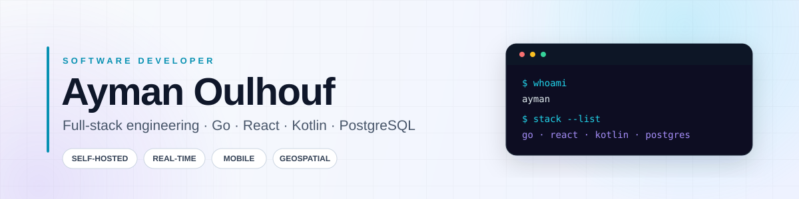

  <picture>
    <source media="(prefers-color-scheme: dark)" srcset="https://raw.githubusercontent.com/AYMANOULHOUF/AYMANOULHOUF/main/assets/banner-dark.svg">
    <source media="(prefers-color-scheme: light)" srcset="https://raw.githubusercontent.com/AYMANOULHOUF/AYMANOULHOUF/main/assets/banner-light.svg">
    
  </picture>

## Hey, I'm Ayman 👋

I build **complete, self-hostable software** — from the database schema and API to the web dashboard and mobile client. I like turning a real operational problem into a clean, deployable product that someone can actually run.

- 🛰️ Currently building **TrackStack**, a self-hosted fleet & GPS tracking platform
- 🧱 Working across the stack with **Go, React, Kotlin, PostgreSQL/PostGIS, and Docker**
- 🎓 Grounded in **BTS DAI** coursework: web development, Python, C, MERISE, OS, and computer architecture
- 🌍 Based in **Larache, Morocco** · happy to collaborate on useful, well-built software
- 💬 Ask me about **Go APIs, React dashboards, Android foreground services, or PostGIS**

> I care about software that is understandable, deployable, and actually useful.

---

## 🛠️ Tech Stack

**Languages**

  
  
  
  
  
  
  
  
  

**Backend & Data**

  
  
  
  
  
  

**Frontend**

  
  
  
  
  
  
  

**Mobile**

  
  
  
  
  

**DevOps & Tools**

  
  
  
  
  
  

---

## 🚀 Featured Projects

<table>
  <tr>
    <td width="50%" valign="top">
      <h3>🛰️ TrackStack</h3>
      
Self-hosted fleet &amp; GPS tracking platform with a Go API, React + Leaflet dashboard, Kotlin Android app, and PostGIS storage.

      
<strong>Highlights:</strong> real-time WebSocket map, geofences, speed events, multi-tenant organizations, Android foreground tracking.

      
<code>Go</code> <code>React</code> <code>Kotlin</code> <code>PostgreSQL</code> <code>Docker</code>

      

        
      

    </td>
    <td width="50%" valign="top">
      <h3>🎓 BTS Larache Dashboard</h3>
      
A dark-mode learning hub for my BTS DAI journey: modules, coursework, C# desktop apps, and creative work in one single-page app.

      
<strong>Highlights:</strong> responsive dashboard UI, module hub, C# .NET 8 WinForms showcase, flyers and brand identity portfolio.

      
<code>HTML5</code> <code>CSS3</code> <code>JavaScript</code> <code>C#</code>

      

        
        
      

    </td>
  </tr>
  <tr>
    <td width="50%" valign="top">
      <h3>🧠 Quiz Game</h3>
      
A responsive vanilla-JavaScript quiz built to practice DOM manipulation, state management, and instant user feedback.

      
<strong>Highlights:</strong> instant answer validation, live score and progress, result messages, clean restart flow.

      
<code>JavaScript</code> <code>HTML5</code> <code>CSS3</code>

      

        
        
      

    </td>
    <td width="50%" valign="top">
      <h3>📂 More on GitHub</h3>
      
I use GitHub to document what I build and what I learn — from full-stack platforms to smaller exercises and coursework.

      
<strong>Open to:</strong> collaboration, code reviews, and conversations about self-hosted software.

      

        
      

    </td>
  </tr>
</table>

---

## 🛰️ Currently Building: TrackStack

TrackStack is a self-hosted platform for tracking phones and GPS hardware. It is designed as a real product, not a demo: multi-tenant organizations, device tokens, live map updates, geofences, speed limits, trip history, and an Android client.

| Layer | What I built |
| --- | --- |
| **API** | Go + Chi, JWT for dashboard users, long-lived tokens for devices, REST + WebSocket |
| **Data** | PostgreSQL 16 + PostGIS 3.4, positions, geofences, speed events, trips, audit log |
| **Web** | React 19 + Vite, TanStack Query, Leaflet + OpenStreetMap, responsive dark UI |
| **Mobile** | Kotlin + Jetpack Compose, foreground location service, osmdroid map, device enrollment |
| **Deploy** | Docker Compose, Caddy reverse proxy, PostGIS container, SQL migrations |

  
  

  
<b>TrackStack roadmap</b>

  - Automated trip segmentation worker
  - Geofence drawing UI
  - Email and Web Push notification delivery
  - Hardware protocol adapters for physical GPS trackers
  - iOS client

---

## 📊 GitHub at a Glance

  

  
  

  

---

## 📚 Background & Continuous Learning

My foundation comes from **BTS DAI (Développement d'Applications Informatiques)** coursework, where I worked through:

- Web development with HTML, CSS, and JavaScript
- Python programming
- C and linked data structures
- MERISE database design
- Operating systems and computer architecture

I'm currently going deeper into production Go, geospatial data with PostGIS, Android background execution, and system design.

---

## 🤝 Let's Connect

I'm always happy to talk about software, self-hosting, or a project idea.

Best way to reach me is by email or by opening an issue on one of my repositories.

---

  Thanks for stopping by — build something useful.

